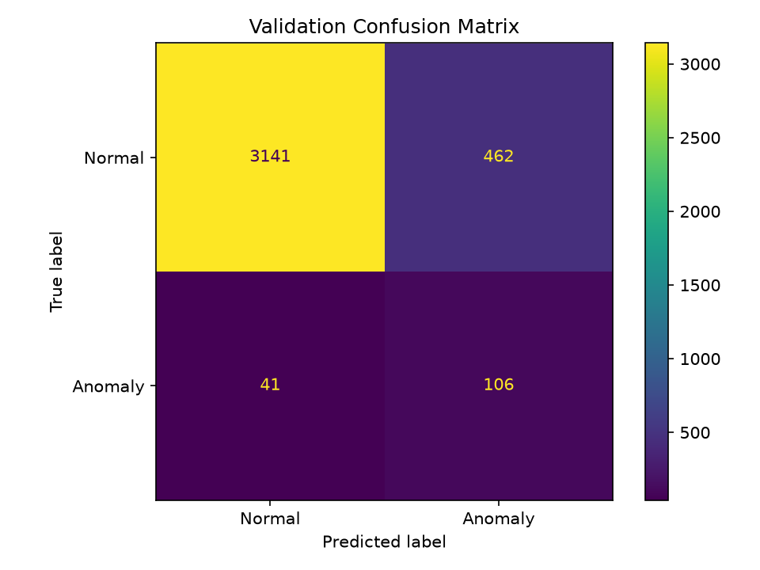
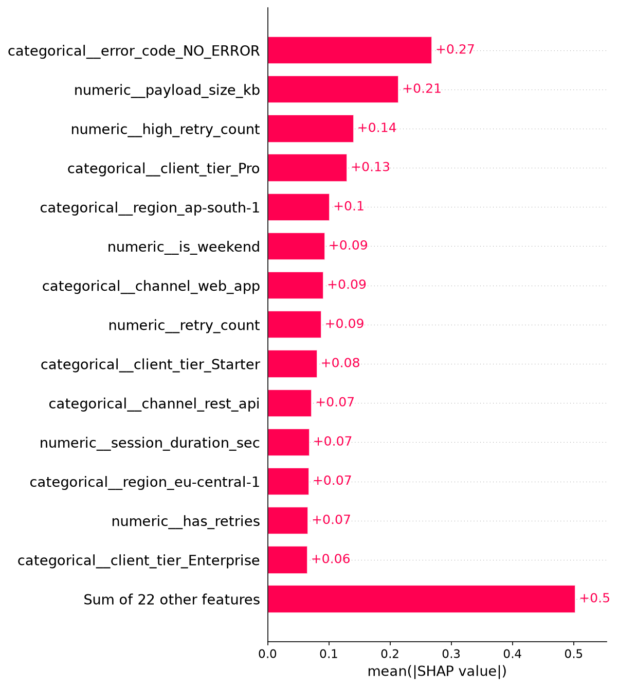
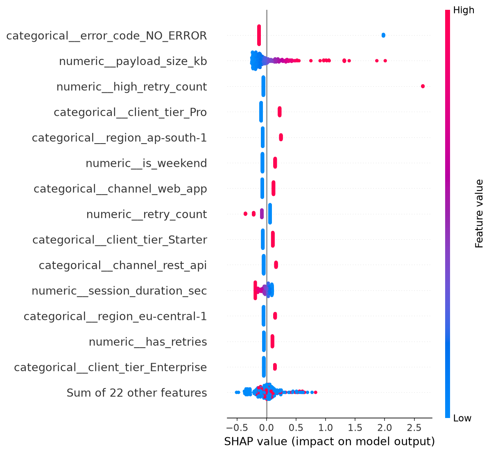
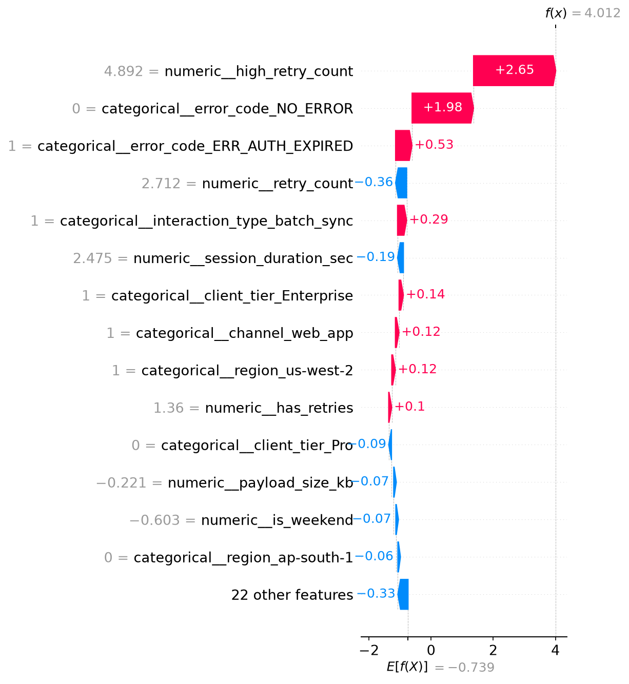

# 📊 Telemetry Anomaly Detection

An end-to-end Machine Learning project developed as part of the **Attenomy Machine Learning Engineering Internship practice program**.

This project focuses on detecting anomalous patterns in telemetry data using supervised machine learning. It covers data preprocessing, feature engineering, model comparison, hyperparameter tuning, decision threshold optimization, error analysis, model explainability, and probability calibration experiments.

## 🎯 Project Objectives

* Prepare and analyze telemetry data for machine learning.
* Engineer meaningful features to improve anomaly detection.
* Compare Logistic Regression, LightGBM, and XGBoost.
* Tune model hyperparameters and decision thresholds.
* Evaluate model performance using precision, recall, F1-score, ROC-AUC, and PR-AUC.
* Investigate False Positives and False Negatives.
* Explain model predictions using SHAP.
* Explore probability calibration.
* Maintain an automated test suite for project reliability.

## 🛠️ Technology Stack

* **Language:** Python
* **Data Processing:** pandas, NumPy
* **Machine Learning:** scikit-learn, LightGBM, XGBoost
* **Explainable AI:** SHAP
* **Visualization:** Matplotlib
* **Testing:** pytest
* **Development:** Jupyter Notebook
* **Model Serialization:** Joblib

## 📁 Project Structure

```text
ml-engineer-internship/
├── data/
│   └── clean/
├── models/
│   └── best_model.joblib
├── notebooks/
│   └── 04_tuning.ipynb
├── reports/
│   ├── confusion_matrix.png
│   ├── calibration_curve.png
│   ├── calibration_model_comparison.csv
│   ├── error_analysis_10_fp_10_fn.csv
│   ├── feature_group_ablation.csv
│   ├── shap_feature_importance.png
│   ├── shap_summary.png
│   └── shap_waterfall_1.png
├── scripts/
│   ├── error_analysis.py
│   ├── shap_analysis.py
│   ├── calibrate_model.py
│   ├── compare_calibration.py
│   ├── run_feature_ablation.py
│   ├── save_best_model.py
│   └── tune_boosting_models.py
├── src/
├── tests/
├── requirements.txt
├── pyproject.toml
├── LEARNING_LOG.md
└── README.md
```

*Note: This structure highlights the main project files. Additional scripts and reports may be available in their respective directories.*

## ⚙️ Machine Learning Workflow

### 1. Data Preprocessing and Exploration

The project builds on the telemetry data preparation and exploratory analysis work completed in the internship practice repository.

The workflow includes data preparation, preprocessing, feature analysis, and training, validation, and test data separation.

### 2. Feature Engineering

Several engineered feature groups were investigated:

* Payload-to-session-duration relationships.
* Log transformations of payload size and latency.
* Retry-related indicators.
* Error-related indicators.
* Time-based features.

Feature group ablation experiments were performed to examine how different feature groups affected model performance.

### 3. Model Comparison and Tuning

The following models were explored:

* Logistic Regression
* LightGBM
* XGBoost

Hyperparameter tuning and validation-based comparisons were conducted using metrics suitable for an imbalanced anomaly detection problem.

The current saved model is **Logistic Regression**, configured with a decision threshold of **0.85**.

Model selection should consider the trade-off between detecting anomalies and incorrectly flagging normal records. Results from different models and thresholds should be compared using consistent evaluation conditions.

## 📈 Validation Results

The selected Logistic Regression model was evaluated on **3,750 validation records** using a decision threshold of 0.85.

| Metric             | Validation Result |
| ------------------ | ----------------: |
| Accuracy           | Approximately 94% |
| Anomaly Precision  |              0.31 |
| Anomaly Recall     |              0.35 |
| Anomaly F1-score   |              0.33 |
| Validation Samples |             3,750 |

These are validation results, not final test-set results.

Accuracy alone is insufficient for evaluating an imbalanced anomaly detection problem. The relatively low anomaly recall indicates that the model misses a substantial proportion of actual anomalies.

### Confusion Matrix

The confusion matrix summarizes the classification results at the selected decision threshold.



## 🔎 Error Analysis

The validation error analysis identified:

* **114 False Positives:** Normal records incorrectly classified as anomalies.
* **96 False Negatives:** Actual anomalies incorrectly classified as normal.

The project saves incorrect predictions and representative examples for further investigation.

Key outputs include:

* `reports/validation_errors.csv`
* `reports/error_summary.csv`
* `reports/error_analysis_10_fp_10_fn.csv`

This analysis helps identify difficult cases and potential opportunities for improving feature engineering, model selection, and threshold selection.

## 🧠 Model Explainability with SHAP

SHAP was used to investigate feature contributions to model predictions.

The analysis generates feature importance results, a SHAP summary plot, and individual waterfall plots.

### Feature Importance



### SHAP Summary



### Individual Prediction Explanation



These visualizations help investigate why the model assigns different anomaly scores to individual records.

SHAP explanations describe the model's behavior; they do not independently establish the real-world cause of an anomaly.

## 📉 Probability Calibration

Probability calibration was explored using sigmoid calibration.

The original and calibrated models were compared using:

* Brier score
* Log loss
* ROC-AUC
* PR-AUC

The comparison results are available in:

* `reports/calibration_curve.png`
* `reports/calibration_model_comparison.csv`
* `reports/calibration_results.csv`
* `reports/calibration_summary.csv`

The calibrated model has **not** replaced the current saved model. Calibration and threshold selection require careful validation before the calibrated model can be adopted.

## 🚀 Installation and Setup

### Prerequisites

* Python
* Git
* pip

### 1. Clone the Repository

```powershell
git clone https://github.com/Abhinav55849/attenomy-ml-practice.git
cd attenomy-ml-practice
```

### 2. Create a Virtual Environment

```powershell
python -m venv .venv
```

### 3. Activate the Environment

```powershell
.\.venv\Scripts\Activate.ps1
```

### 4. Install Dependencies

```powershell
python -m pip install --upgrade pip
pip install -r requirements.txt
```

### 5. Run the Tests

```powershell
pytest
```

The latest recorded test run completed with **28 passed tests**.

## 🧪 Running Analysis Scripts

Run the following commands from the repository root.

### Error Analysis

```powershell
python .\scripts\error_analysis.py
```

### SHAP Analysis

```powershell
python .\scripts\shap_analysis.py
```

### Probability Calibration

```powershell
python .\scripts\calibrate_model.py
python .\scripts\compare_calibration.py
```

### Feature Ablation

```powershell
python .\scripts\run_feature_ablation.py
```

These scripts may regenerate files in the `reports/` directory. Ensure the required dataset and dependencies are available before running them.

## ⚠️ Limitations

* The current model has relatively low anomaly recall.
* False positives may generate unnecessary alerts.
* Some actual anomalies remain undetected.
* Calibration results require further validation before adoption.
* Performance may vary with changes in telemetry data and anomaly patterns.
* The project has not been established as production-ready.
* Final test-set performance has not been reported in this README.

## 🔮 Future Improvements

* Improve anomaly recall while controlling false positives.
* Investigate difficult validation examples.
* Evaluate alternative models and decision thresholds systematically.
* Validate probability calibration on appropriate held-out data.
* Evaluate the selected model on the untouched test set.
* Package inference using FastAPI.
* Improve reproducibility of training and evaluation.
* Add monitoring for changes in data distributions and model performance.

## 📌 Project Status

The project includes preprocessing and feature engineering work, model comparison and tuning, validation-based threshold selection, error analysis, SHAP explainability, calibration experiments, and automated tests.

The current saved artifact is a Logistic Regression model with a decision threshold of 0.85.

The reported metrics are validation results. Further evaluation and improvement are needed before considering production deployment.

## 👨‍💻 Author

**Abhinav Singh**

B.Tech — Computer Science and Engineering
Artificial Intelligence and Machine Learning

GitHub: [Abhinav55849](https://github.com/Abhinav55849)

---

*Developed as part of machine learning engineering practice using the Attenomy internship starter repository.*
